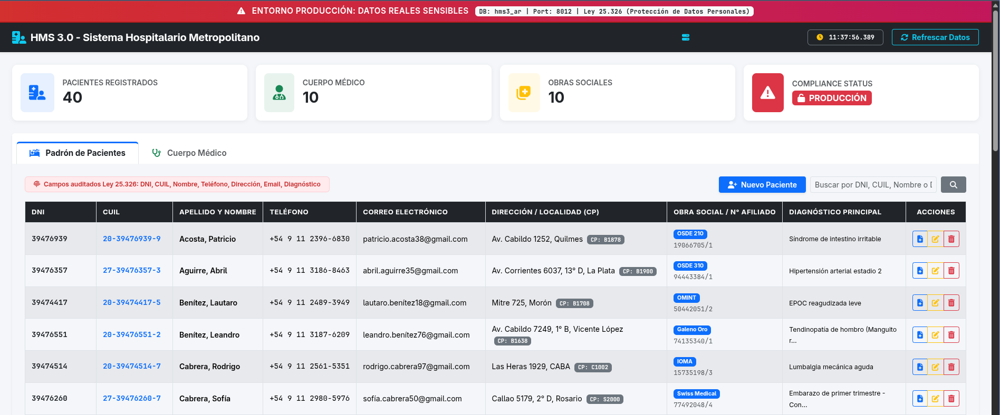

# HMS 3.0 - Metropolitan Hospital Management System
### Delphix Continuous Data , Continuous Compliance & Data Control Tower Demonstration Platform

[](https://www.delphix.com)
[](https://www.delphix.com)
[](https://www.delphix.com)
[](https://www.microsoft.com/sql-server)
[](https://www.djangoproject.com)
[](https://podman.io)

<p align="center">
  
</p>

---

## 📋 Executive Overview

**HMS 3.0** is a hospital management reference application built specifically for **Presales Engineers, Solution Architects, and Technical Consultants** demonstrating the capabilities of **Perforce Delphix Continuous Data**, **Perforce Delphix Continuous Compliance**, and **Perforce Data Control Tower (DCT)** against **Microsoft SQL Server**.

> [!NOTE]
> **Demonstration Architecture Notice**: In HMS 3.0, "Production" and "Test" describe simulated data lifecycle roles used for demonstration purposes. All patient, physician, and clinical records are synthetically generated to model realistic regulated data patterns; no real patient data is included.

It showcases key end-to-end data lifecycle capabilities:
1. **Automated Sensitive Data Discovery & Profiling**: Native table and column naming conventions tailored for Delphix Profilers across three international regulatory jurisdictions.
2. **Consistent & Deterministic Data Masking**: Replaces Personally Identifiable Information (PII) and Protected Health Information (PHI) with synthetic equivalents while preserving referential consistency across related tables when deterministic algorithms are configured.
3. **Storage-Efficient Virtual Database (VDB) Provisioning**: Delivers rapid, space-efficient virtual copies of SQL Server databases for development and test (UAT/QA) without duplicating physical storage blocks.
4. **Self-Service VDB Lifecycle (Rewind / Refresh / Bookmarks)**: Demonstrates point-in-time recovery (Rewind) and baseline resets directly via Perforce Data Control Tower (DCT) or the Continuous Data Engine.

---

## 🚦 Quick Start: From Zero to a Working Demo

Follow these steps in order. Each one says what to run and what you should see. The examples use Argentina (`ar`); for Brazil or USA replace `ar` with `br` or `us`, and `seed_argentina` with `seed_brazil` or `seed_usa`.

### What You Need
* A Linux host with **Podman** (or Docker), **Python 3**, **git** and `sudo`.
* A **SQL Server** instance reachable from that host on port `1433`, and a login allowed to create a database and its tables (the examples use `sa`). You do not need to create the database: the seed command does it.
* Ports **8012** (Production) and **8013** (Test) free on the host.
* Internet access **only to build the image**. Running the demo needs no internet.

### Step 1. Get the Code
```bash
git clone <repository-url> hms3
cd hms3
```

### Step 2. Create the Configuration File
Copy the template for the Production environment of your country and edit it:
```bash
cp .env-prod-ar.example .env-prod-ar
vi .env-prod-ar
```
Change only these two values; leave the rest as they are:

| Variable | What to put |
| :--- | :--- |
| `DB_HOST` | IP or hostname of your SQL Server |
| `DB_PASSWORD` | Password of the SQL Server login (`DB_USER`, `sa` by default) |

### Step 3. Build the Image
```bash
./hms-ctl.py build
```
The first build downloads the base images and takes a few minutes. It must end with:
```
✔ Image 'hms3-app:1.0' built successfully (build <commit>).
```

### Step 4. Start Production
```bash
./hms-ctl.py start -e prod -c ar
```
**The first time, this warning is expected** because the database has no tables yet:
```
⚠ Application is running at http://<HOST-IP>:8012/ but the DATABASE IS NOT AVAILABLE (hms3_ar).
```
Continue with the next step.

### Step 5. Load the Data
```bash
sudo podman exec hms3_prod python manage.py seed_argentina
```
This creates the database if it does not exist, creates the three tables and loads 12 specialties, 10 physicians and 40 patients. It must end with a line starting with `¡Éxito!` (`Sucesso!` for Brazil, `Success!` for USA).

> If you use rootless Podman (`HMS_ROOTLESS=1`) omit `sudo`. With Docker, use `sudo docker exec`.

### Step 6. Verify
```bash
./hms-ctl.py status
```
The `hms3_prod` row must show `RUNNING` and `OK (40 pat.)`:
```
PROJECT      ENV    COUNTRY  PORT   STATUS       HEALTH           BUILD          URL
hms3_prod    prod   AR       8012   RUNNING      OK (40 pat.)     <commit>       http://<HOST-IP>:8012/
```
Open `http://<HOST-IP>:8012/` in a browser: you must see the red Production banner and the patient list.

### Step 7. Create the Masked Copy with Delphix
Do this in the Delphix products, as described in the [Presales Demonstration Playbook](#-presales-demonstration-playbook) (Steps 2 to 4):
1. Link the database `hms3_ar` as a **dSource**.
2. Provision the **VDB** `vhms3_ar`.
3. Profile and mask the VDB, following the [Masking Ruleset Guidelines](#masking-ruleset-guidelines).

### Step 8. Start Test (the Masked VDB)
```bash
cp .env-test-ar.example .env-test-ar
vi .env-test-ar          # set DB_HOST and DB_PASSWORD of the SQL Server that hosts the VDB
./hms-ctl.py start -e test -c ar
./hms-ctl.py status
```
**Do not run a seed command on Test**: its data comes from the VDB. Open `http://<HOST-IP>:8013/`: you must see the green banner and the masked data.

### Everyday Commands
| I want to... | Command |
| :--- | :--- |
| See if everything works | `./hms-ctl.py status` |
| Stop an environment | `./hms-ctl.py stop -e prod -c ar` |
| Start it again | `./hms-ctl.py start -e prod -c ar` |
| See the application logs | `./hms-ctl.py logs -e prod -c ar` |
| Regenerate Production data from scratch | `sudo podman exec hms3_prod python manage.py seed_argentina --clean` |
| Apply code changes (rebuild and recreate) | `./hms-ctl.py restart -e prod -c ar --build` |
| Switch an environment to another country | `./hms-ctl.py rm -e prod -c ar -f` and then `./hms-ctl.py start -e prod -c br` |

If something does not look like described here, go to [Troubleshooting](#-troubleshooting).

---

## 🌍 Multi-Country Regulatory Architecture

HMS 3.0 supports **three independent country modes**, dynamically selected via the `HMS_COUNTRY` and `DB_NAME` environment variables. The application adapts its database schema, table names, sensitive column identifiers, UI language, clinical terminologies, and regulatory notices accordingly.

```
                      ┌──────────────────────────────────────┐
                      │          HMS 3.0 Application         │
                      │       Environment: HMS_COUNTRY       │
                      └──────────────────┬───────────────────┘
                                         │
         ┌───────────────────────────────┼──────────────────────────────┐
         ▼                               ▼                              ▼
  🇦🇷 ARGENTINA                    🇧🇷 BRAZIL                      🇺🇸 UNITED STATES
  ───────────────────────         ───────────────────────        ───────────────────────
  Standard: Ley 25.326            Standard: LGPD (13.709)        Standard: HIPAA (PHI)
  Language: Spanish               Language: Portuguese           Language: English
  Prod DB : hms3_ar               Prod DB : hms3_br              Prod DB : hms3_us
  Test VDB: vhms3_ar              Test VDB: vhms3_br             Test VDB: vhms3_us
```

### Country Comparison Matrix

| Attribute / Field | 🇦🇷 Argentina (AR) | 🇧🇷 Brazil (BR) | 🇺🇸 United States (US) |
| :--- | :--- | :--- | :--- |
| **Regulatory Context** | Ley 25.326 (Protección Datos)* | LGPD (Lei 13.709/2018)* | HIPAA (45 CFR § 164.514)* |
| **Simulated Production DB** | `hms3_ar` | `hms3_br` | `hms3_us` |
| **Test Virtual Database** | `vhms3_ar` | `vhms3_br` | `vhms3_us` |
| **Patients Table** | `dbo.PACIENTES` | `dbo.PACIENTES` | `dbo.PATIENTS` |
| **Doctors Table** | `dbo.MEDICOS` | `dbo.MEDICOS` | `dbo.DOCTORS` |
| **Specialties Table** | `dbo.ESPECIALIDADES` | `dbo.ESPECIALIDADES` | `dbo.SPECIALTIES` |
| **App Document 1 (`doc_primary` / `col_doc1`)** | `DNI` (Documento Nacional) | `RG` (Registro Geral) | `STATE_ID` (State Driver License / ID) |
| **App Document 2 (`doc_secondary` / `col_doc2`)** | `CUIL` (Identificación Laboral) | `CPF` (Cadastro de Pessoas Físicas) | `SSN` (Social Security Number) |
| **Primary Federal / Tax Identifier** | `CUIL` (Módulo 11) | `CPF` (Receita Federal) | `SSN` (Social Security Administration) |
| **Medical License ID** | `MATRICULA_NACIONAL` (MN) | `CRM` (Conselho Regional) | `NPI` (National Provider Identifier) |
| **Street Address** | `DIRECCION` | `ENDERECO` | `ADDRESS` |
| **City / Locality** | `LOCALIDAD` | `CIDADE` | `CITY` |
| **Province / State** | `PROVINCIA` (Full name, 60) | `ESTADO` (UF code, 10) | `STATE` (State code, 10) |
| **Postal Code** | `CODIGO_POSTAL` (CP) | `CEP` | `ZIP_CODE` |
| **Health Insurance & Policy** | `OBRA_SOCIAL` / `NUMERO_AFILIADO` | `CONVENIO` / `NUMERO_CARTEIRINHA`| `INSURANCE_PROVIDER` / `POLICY_NUMBER` |
| **Clinical Diagnosis** | `DIAGNOSTICO_CLINICO` (150) | `DIAGNOSTICO` (150) | `DIAGNOSIS` (150) |
| **Clinical Notes / Sensitive Health Data** | `HISTORIA_CLINICA` | `PRONTUARIO` | `CLINICAL_NOTES` (PHI) |

*\* Regulatory references describe representative data patterns modeled by the application; HMS 3.0 does not certify formal legal compliance.*

---

## 🏛️ Model Parity & Architectural Consistency

HMS 3.0 balances regional authenticity with technical uniformity:

* **Same Business Domain**: All three variants represent the same underlying healthcare domain (patients, medical staff, dynamic specialties, insurance coverage, and clinical evolutions).
* **Localized Physical Schemas**: Table and column names remain in the native language and format of each region, allowing Delphix profilers to detect realistic patterns without generic abstractions.
* **Harmonized Field Specifications**: Equivalent business attributes have been aligned across regions (First and Last Names: `VARCHAR(60)`, Street Address: `VARCHAR(120)`, Locality/City: `VARCHAR(60)`, Phone: `VARCHAR(25)`, Email: `VARCHAR(100)`, Diagnosis: `VARCHAR(150)`, Clinical Notes: `TEXT/NVARCHAR(MAX)`).
* **Justified Regional Differences**: Legitimate local distinctions are preserved (e.g. Argentine province full names vs 2-character Brazilian UF and US State codes; numeric DNI length vs formatted CPF/SSN lengths).
* **Minimal Patient Creation**: For demonstration convenience, only **First Name** and **Last Name** are required when manually adding a patient. Other database fields (document identifiers, default birth date `1990-01-01`) can be completed automatically by HMS 3.0.

---

## 🎯 Delphix Profiler Discovery Architecture

Delphix Continuous Compliance profiling can classify sensitive data using metadata/path matching, data types, regular expressions, value lists, and data-level classifiers (such as Automated Sensitive Data Discovery - ASDD), depending on the selected profile set and engine version.

### Why Native Schemas Matter for Presales
In demonstration environments, generic column names often fail to trigger standard profiling rules (e.g. naming a Brazilian CPF column `national_id_number` or `doc_2`). 

HMS 3.0 uses **native uppercase schemas** for each country:
* **Brazil**: Columns `CPF`, `RG`, and `CRM` are designed to trigger common built-in or custom Brazilian profiling classifiers.
* **USA**: Columns `SSN`, `STATE_ID`, `NPI`, `ZIP_CODE`, and `CLINICAL_NOTES` provide representative metadata designed to align with common Delphix built-in US PII and HIPAA profiling classifiers.
* **Argentina**: Columns `DNI` and `CUIL` align with standard Argentine custom plugins or profile expressions (`AR_DNI`, `AR_CUIL`/`AR_CUIT`) in Perforce Profile Sets.

---

## ⚡ Cache-Controlled Multi-Environment Architecture

A key challenge during live demonstrations is comparing **Simulated Production (Port 8012)** against **Masked Test VDB (Port 8013)** simultaneously. HMS 3.0 addresses browser caching and cookie isolation:

1. **Environment Cookie Isolation**:
   * The CSRF cookie is dynamically suffixed with the active environment (the app uses no sessions or logins):
     ```python
     CSRF_COOKIE_NAME = f'hms3_csrf_{HMS_ENV}'
     ```
   * This permits opening Production and Test VDB in **adjacent tabs of the same browser window** without cookie collisions.

2. **HTTP Anti-Cache Headers (`NoCacheMiddleware`)**:
   * Every HTTP response emits strict anti-caching headers (`no-cache, no-store, must-revalidate`).

3. **Client-Side Freshness Bypass**:
   * The **`[🔄 Refresh Data]`** button in the top navigation bar forces a clean reload appending a cache-busting timestamp parameter (`?_nocache=<timestamp>`).

4. **Safe Dynamic Data Rendering**:
   * Dynamic patient and clinical values are populated into the DOM as plain text rather than interpreted as raw HTML, ensuring resilient presentation of arbitrary clinical inputs.

5. **Demo Instrumentation Banners**:
   * **Production (Port 8012)**: Crimson red banner indicating simulated production:
     `PRODUCTION ENVIRONMENT: REAL SENSITIVE DATA | DB: hms3_us | Port: 8012 | HIPAA Protected Health Information (PHI)`
   * **Test VDB (Port 8013)**: Forest green banner indicating compliant masked data:
     `NON-PRODUCTION ENVIRONMENT: MASKED DATA | DB: vhms3_us | Port: 8013 | HIPAA Protected Health Information (PHI)`
   * **Visible Instrumentation**: Active database host, port, database name, and container port are intentionally displayed in the UI as demo instrumentation to verify topology during presentations.
   * **Live Server Clock**: Provides a visible freshness and active request indicator in the navbar during side-by-side demonstrations.

---

## 📦 Container Image Building

HMS 3.0 uses an optimized multi-stage build in `Dockerfile.django`:
* **Build Stage**: Based on `python:3.11-bookworm` with compilation tools and pre-built Python wheels.
* **Runtime Stage**: Based on `python:3.11-slim-bookworm` with Microsoft's official ODBC Driver 18 for SQL Server.

### Build the Image
Build the container image using the built-in CLI manager (which automatically detects Podman or Docker):
```bash
./hms-ctl.py build
```

Or build manually using Podman or Docker:
```bash
# Using Podman (or omit sudo if using rootless mode)
sudo podman build -t hms3-app:1.0 -f Dockerfile.django .

# Using Docker
sudo docker build -t hms3-app:1.0 -f Dockerfile.django .
```

### Build and Publish to a Container Registry
`build-and-push.sh` builds the image (through `hms-ctl.py build`, so it is stamped with the repo commit) and pushes it to a container registry such as the GitLab Container Registry, with the tags `1.0` and `latest`.

1. **Configure the destination (once).** Copy the template and set your registry path. `.env-registry` is excluded from git, so internal hostnames are not published:
   ```bash
   cp .env-registry.example .env-registry
   # edit .env-registry: HMS_REGISTRY_IMAGE=<registry-host>:<port>/<group>/<project>/hms3-app
   ```
2. **Log in to the registry (once per host).** Use the same engine and privilege level that will run the build. With the default `sudo podman`:
   ```bash
   sudo podman login <registry-host>:<port> -u <user>
   ```
   Enter your password or a Personal Access Token with the `read_registry` and `write_registry` scopes.
3. **Commit your changes.** With uncommitted changes the image is stamped as `<commit>-dirty`.
4. **Build and push:**
   ```bash
   ./build-and-push.sh
   ```

After building, continue with [Quick Start, Step 4](#step-4-start-production) to start the application and load its data.

The script stops before building if there is no registry session. It uses `sudo podman`, like `hms-ctl.py`; export `HMS_ROOTLESS=1` to use rootless `podman` (and log in without `sudo`).

---

## ⚙️ Configuration & Environment Templates

HMS 3.0 provides pre-configured template files (`.example`) for each environment and jurisdiction:

| Template File | Environment | Country | Port | Database | Real Config (Local Only) |
| :--- | :--- | :--- | :--- | :--- | :--- |
| `.env-prod-ar.example` | Production | Argentina (`AR`) | `8012` | `hms3_ar` | `.env-prod-ar` |
| `.env-test-ar.example` | Test VDB | Argentina (`AR`) | `8013` | `vhms3_ar` | `.env-test-ar` |
| `.env-prod-br.example` | Production | Brazil (`BR`) | `8012` | `hms3_br` | `.env-prod-br` |
| `.env-test-br.example` | Test VDB | Brazil (`BR`) | `8013` | `vhms3_br` | `.env-test-br` |
| `.env-prod-us.example` | Production | USA (`US`) | `8012` | `hms3_us` | `.env-prod-us` |
| `.env-test-us.example` | Test VDB | USA (`US`) | `8013` | `vhms3_us` | `.env-test-us` |

> **Security Notice**: All real `.env*` configuration files containing active database credentials are strictly excluded via `.gitignore`. Copy the appropriate `.example` file to its corresponding `.env-*` filename and configure your local SQL Server connection credentials. The placeholder IPs (such as `10.0.0.10`) and credentials in `.example` files are illustrative and do not represent real infrastructure.

### Environment Variable Reference

```ini
# Core Configuration
DJANGO_SECRET_KEY=hms3-secret-key-replace-in-production
ALLOWED_HOSTS=*
DEBUG=False                   # Keep False for demos: no tracebacks on screen

# Environment & Localization
HMS_ENV=prod                  # 'prod' (8012) or 'test' (8013)
HMS_COUNTRY=US                # 'AR', 'BR', or 'US'
HMS_CONTAINER_NAME=hms3_prod  # 'hms3_prod' or 'hms3_test'
HOST_PORT=8012                # Port mapped on the host

# SQL Server Instance Connection
DB_HOST=<SQL_SERVER_HOST>     # SQL Server IP or Hostname
DB_PORT=1433                  # Default SQL Server Port
DB_NAME=hms3_us               # Target Database
DB_USER=sa                    # SQL Server User
DB_PASSWORD=YourStrongPasswordHere  # SQL Server Password

# Optional (defaults shown): seconds before giving up on a database that does not answer
DB_CONNECT_TIMEOUT=5
DB_QUERY_TIMEOUT=30
```

---

## 🚀 Container Orchestration CLI (`hms-ctl.py`)

HMS 3.0 includes an all-in-one Python CLI controller (**`hms-ctl.py`**) that supports both **Podman** and **Docker** using only the Python standard library.

```bash
./hms-ctl.py <command> -e <prod|test> -c <ar|br|us>
```

### Available Commands

| Command | Arguments | Description |
| :--- | :--- | :--- |
| `start` | `-e <prod\|test> -c <ar\|br\|us> [-b]` | Starts the container environment and verifies the app answers and can read its database (refuses to overwrite existing instances; optionally `-b` to rebuild image). |
| `stop` | `-e <prod\|test> -c <ar\|br\|us> [-t seconds]` | Cleanly stops the container (default graceful timeout: 2s). |
| `restart` | `-e <prod\|test> -c <ar\|br\|us> [-b]` | Restarts the existing container environment (optionally `-b` to rebuild image). |
| `status` | `[-e <prod\|test>] [-c <ar\|br\|us>]` | Displays a live summary table of all environments (ports 8012 & 8013), including the real health check (database reachable, patient count) and the image build. |
| `logs` | `-e <prod\|test> -c <ar\|br\|us> [-f] [-n lines]` | Displays or follows live container logs. |
| `rm` | `-e <prod\|test> -c <ar\|br\|us> [-f]` | Removes the container cleanly without errors if missing (`-f` to force remove if running). |
| `build` | `[-t tag] [--no-cache]` | Rebuilds the HMS 3.0 container image. |

### CLI Examples

```bash
# Start environments
./hms-ctl.py start -e prod -c ar       # Production Argentina on port 8012
./hms-ctl.py start -e test -c br       # Non-Production (masked) Brazil on port 8013

# Check status of all environments (or filtered)
./hms-ctl.py status
./hms-ctl.py status -e prod

# Follow live container logs
./hms-ctl.py logs -e prod -c ar -f

# Restart existing container cleanly
./hms-ctl.py restart -e prod -c ar

# Clean stop and removal
./hms-ctl.py stop -e prod -c ar
./hms-ctl.py rm -e prod -c ar -f
```

> [!NOTE]
> **Container Execution Mode**: By default, `hms-ctl.py` uses `sudo` if present (rootfull execution), ensuring reliable binding to ports and standard networking. When interacting directly with containers launched by `hms-ctl.py` (e.g. `exec`), use `sudo podman` or `sudo docker`. To operate in rootless mode, export `HMS_ROOTLESS=1` before invoking `hms-ctl.py`.

---

## 🧪 Database Seeding & Synthetic Data Generators

HMS 3.0 includes dedicated Django management commands to populate databases with realistic synthetic datasets designed to demonstrate common PII/PHI patterns found in regulated environments.

* **Source Dataset**: Synthetically generated but intentionally unmasked, serving as the simulated production baseline.
* **Test Dataset**: Derived from that source via Delphix Continuous Data virtualization and transformed by Delphix Continuous Compliance masking algorithms.

### 1. Seeding Argentina (`seed_argentina`)
* **Identifiers**: Generates realistic synthetic Argentine DNIs and Modulo 11 checksum-compatible CUILs (`20-XXXXXXXX-X`, `27-XXXXXXXX-X`, `23-XXXXXXXX-X`).
* **Medical Licensing**: Generates realistic synthetic Matrícula Nacional (MN) and Provincial (MP) values.
* **Command Syntax**:
  ```bash
  # Prepend sudo to match hms-ctl rootfull execution (omit sudo only if HMS_ROOTLESS=1)
  sudo podman exec hms3_prod python manage.py seed_argentina --clean
  ```

### 2. Seeding Brazil (`seed_brazil`)
* **Identifiers**: Generates synthetic CPFs calculated with Modulo 11 check digits (`XXX.XXX.XXX-XX`), and realistic synthetic RGs.
* **Medical Licensing**: Generates realistic Conselho Regional de Medicina (CRM) values with State jurisdiction codes (`CRM/SP`, `CRM/RJ`).
* **Command Syntax**:
  ```bash
  sudo podman exec hms3_prod python manage.py seed_brazil --clean
  ```

### 3. Seeding USA (`seed_usa`)
* **Identifiers**: Generates synthetic SSN-format identifiers with standard structural exclusions (omitting area `000`, `666`, group `00`, or serial `0000`), plus synthetic State IDs.
* **Medical Licensing**: Generates synthetic 10-digit NPI-format values using the **Luhn Modulo 10 check digit** algorithm (10-digit values starting with `1` or `2`).
* **Command Syntax**:
  ```bash
  sudo podman exec hms3_prod python manage.py seed_usa --clean
  ```

### Seeding Command Options
All three seeding commands accept the following options:
* `--clean`: Drops and recreates the three tables of that country, so new records begin sequentially at **ID 1**. It is the only way to delete data.
* `--pacientes <N>`: Number of patients to generate (default: `40`).
* `--medicos <M>`: Number of physicians to generate (default: `10`).
* `--seed <N>`: Random seed. The same number always generates the same people, which is useful for a scripted demo (birth dates are relative to the current day).

### Seeding Safety Rules
* **Without `--clean` a seeder never deletes anything.** It creates the database and tables if they are missing; if the tables already contain rows or do not match the expected schema, it stops and tells you to use `--clean`.
* **Each seeder only runs in its own country.** `seed_argentina` refuses to run unless the container has `HMS_COUNTRY=AR` (same for `seed_brazil`/`BR` and `seed_usa`/`US`), so a wrong command cannot wipe another country's database.
* **The tables have no `FOREIGN KEY` constraints, on purpose.** SQL Server rejects `TRUNCATE TABLE` on a table referenced by a foreign key, which breaks Delphix on-the-fly masking jobs that use the Truncate option. The relationships (`MEDICO_ID`, `ESPECIALIDAD_ID`, etc.) are plain columns enforced by the application.

### Masking Ruleset Guidelines
* **Include the three tables in the ruleset**, for both in-place and on-the-fly masking. With on-the-fly, a table left out of the ruleset is not copied to the target, and physicians whose specialty row is missing do not show up in the app.
* **The specialties table carries no algorithms.** It is a catalog with no personal data: `ID`, the specialty name (`ESPECIALIDAD` in AR, `ESPECIALIDADE` in BR, `SPECIALTY` in US) and its description. That column is deliberately not called `NOMBRE` / `NOME` / `NAME`, so no profiler mistakes it for a person's name. If profiling ever assigns it an algorithm, remove it.
* **Never mask `ID`, `ESPECIALIDAD_ID` / `ESPECIALIDADE_ID` / `SPECIALTY_ID` or `MEDICO_ID` / `DOCTOR_ID`.** The relationships between the tables depend on those values arriving unchanged.

### Clinical & Diagnostic Consistency
All seeders enforce clinical consistency:
* Each patient is assigned an attending physician.
* The patient's diagnosis and clinical notes (`HISTORIA_CLINICA` / `PRONTUARIO` / `CLINICAL_NOTES`) match the assigned physician's medical specialty.
* Gender consistency is observed for gender-specific specialties (e.g. Gynecology vs Urology).

---

## 🎬 Presales Demonstration Playbook

This step-by-step walkthrough demonstrates how to deliver an impactful Delphix Continuous Compliance & Data Virtualization presentation following the official Delphix presales methodology:

### Step 1: Deploy Simulated Production & Generate Fresh Data
```bash
# 1. Deploy Production (Port 8012) - Example: Argentina
./hms-ctl.py start -e prod -c ar

# 2. Populate fresh, clean records starting at ID 1 (matches hms-ctl rootfull execution)
#    --clean drops and regenerates the data; it also works the first time, on an empty database
sudo podman exec hms3_prod python manage.py seed_argentina --clean

# 3. Verify: the hms3_prod row must show RUNNING and OK (40 pat.)
./hms-ctl.py status
```
> On a database that has never been seeded, step 1 warns that the **database is not available**. That is expected: step 2 creates the tables and the data.

*Show the audience the Production UI at `http://<HOST-IP>:8012/`.* Point out the unmasked DNIs, CUILs, patient names, addresses, and clinical notes under the crimson red Production banner.

### Step 2: Ingest Production (dSource) & Virtualize (VDB Provisioning)
1. In **Perforce Data Control Tower (DCT)** or the **Continuous Data Engine**, link the production SQL Server database (`hms3_ar`, `hms3_br`, or `hms3_us`) as a **dSource**.
2. Complete the initial synchronization/snapshot according to the configured SQL Server ingestion method to establish the Timeflow baseline.
3. Provision a **Virtual Database (VDB)** named `vhms3_ar` (or `vhms3_br` / `vhms3_us`) to the non-production target SQL Server environment.
   * *Highlight to the customer*: VDB provisioning avoids creating a full physical database copy and is typically much faster and more storage-efficient than traditional copy-based provisioning, consuming minimal incremental storage at creation time.

### Step 3: Profile the Non-Production VDB
1. Connect **Perforce Delphix Continuous Compliance** to the newly provisioned non-production VDB (`vhms3_ar`).
2. Execute the **Delphix Profiler** directly against the VDB.
   * *Critical Presales Advantage*: Running discovery on the non-production VDB keeps the profiling workload and its associated operational impact (query overhead, table locks) away from the simulated production database.
3. Demonstrate automated discovery:
   * 🇦🇷 **Argentina**: `DNI`, `CUIL` (matched by `AR_DNI`, `AR_CUIL`/`AR_CUIT` in Perforce Profile Sets), `APELLIDO`, `NOMBRE`, `DIRECCION`, `HISTORIA_CLINICA`.
   * 🇧🇷 **Brazil**: `CPF`, `RG`, `CRM`, `SOBRENOME`, `NOME`, `CEP`, `PRONTUARIO`.
   * 🇺🇸 **USA**: `SSN`, `STATE_ID`, `NPI`, `LAST_NAME`, `FIRST_NAME`, `ZIP_CODE`, `CLINICAL_NOTES`.

### Step 4: Execute In-Place Masking on the VDB
1. Build the Rule Set with the **three tables** and assign the appropriate algorithms only to the sensitive columns (see [Masking Ruleset Guidelines](#masking-ruleset-guidelines)): e.g. `AR_DNI`, `AR_CUIL`, `dlpx-core:Phone Unique`, `First Name`, `Last Name`, `Address`, `Comment / Free Text`).
2. Run the Delphix Masking Job **in-place directly on the VDB**.
   * *Highlight to the customer*: Masking is executed in-place on the target non-production database, avoiding the need to extract or stage sensitive records through separate external application pipelines. When deterministic or consistent masking algorithms are appropriately configured, referential relationships remain preserved.
3. Once the masking job completes, create a VDB bookmark or snapshot in Delphix DCT to establish a clean "Masked Baseline".

### Step 5: Deploy Test Application & Verify Side-by-Side
1. Deploy the Test VDB application container:
   ```bash
   ./hms-ctl.py start -e test -c ar
   ./hms-ctl.py status
   ```
   Both rows must show `RUNNING` and `OK (40 pat.)`. A `BROKEN REFS` health means the masking job left relationships pointing to missing rows: review the Rule Set before showing the result.
2. Open both environments in adjacent browser tabs:
   * **Left Tab (Prod)**: `http://<HOST-IP>:8012/` (Red Banner - Simulated Production Data)
   * **Right Tab (Test VDB)**: `http://<HOST-IP>:8013/` (Green Banner - Masked Non-Production Data)
3. **Key Points to Highlight to the Customer**:
   * With the default seed configuration, patient IDs 1–40 and record counts are preserved between source and masked VDB.
   * Names, identification numbers, and contact details are realistically and consistently masked according to the configured rule set.
   * The hospital application continues operating normally without requiring any application-level changes or reconfigurations.

### Step 6: Simulate UAT Accidental Data Deletion & Regression
1. On the **Test VDB (Port 8013)**, open a patient record (e.g., Patient ID #1).
2. Click **`[🗑️ Delete Record]`** and confirm deletion.
3. Verify that Patient #1 has been removed from the non-production database.
4. **The Traditional Database Restore Bottleneck**:
   * In traditional DevOps environments, recovering from accidental record deletion, broken migrations, or corrupted test runs requires requesting a full physical database restore from DBA / IT operations.
   * Depending on database size, infrastructure, and organizational procedures, traditional restore workflows often take hours or days, causing extended delays for QA and testing.

### Step 7: VDB Rewind / Rollback via Delphix Data Control Tower (DCT)
1. Navigate to **Perforce Data Control Tower (DCT)** or the Continuous Data Engine.
2. Select the VDB (`vhms3_ar`, `vhms3_br`, or `vhms3_us`).
3. Execute a **Rewind / Rollback** to the bookmark or snapshot taken in Step 4 (immediately after masking).
4. Delphix rolls back the database blocks to the clean masked state, substantially reducing recovery time compared with a traditional physical restore workflow.
5. In the HMS 3.0 Test application (Port 8013), click **`[🔄 Refresh Data]`**:
   * Patient ID #1 is restored to its exact original state.
   * No physical backup restoration, no duplicated storage waste, and minimal downtime for the engineering team.

---

## 🛠 Troubleshooting

Start with `./hms-ctl.py status`; for details use `./hms-ctl.py logs -e <prod|test> -c <ar|br|us>`.

| What you see | Why | What to do |
| :--- | :--- | :--- |
| `Configuration file '.env-prod-ar' does not exist.` | The configuration file was not created. | `cp .env-prod-ar.example .env-prod-ar` and set `DB_HOST` and `DB_PASSWORD` (Quick Start, Step 2). |
| `DATABASE IS NOT AVAILABLE` on `start`, `DB DOWN` in `status`, or the page "Database not available" | The app runs but cannot read its tables: the database was never seeded, SQL Server is down or unreachable, `DB_HOST` / `DB_PASSWORD` are wrong, or the VDB is being refreshed or rewound. | First time on Production: run the seed command (Quick Start, Step 5). Otherwise check the values in the `.env-*` file and that SQL Server answers. The page retries by itself every 5 seconds; no restart is needed once the database is back. |
| `the application does not answer on port ...` on `start`, or `NO RESPONSE` in `status` | The container started but the application did not. | Read the logs. `Falta DB_HOST` means the `.env-*` file has no `DB_HOST`; `HMS_COUNTRY inválido` or `HMS_ENV inválido` mean a wrong value in that file. Fix it, then `./hms-ctl.py rm -e prod -c ar -f` and `start` again. |
| Seed: `already has data (...). Nothing was changed.` | The tables already contain rows; a seed never deletes without being told to. | To keep the data, do nothing. To regenerate it, run the seed with `--clean`. |
| Seed: `has tables that do not match the AR schema` | The tables were created by an older version or for another country. | Run the seed with `--clean` to drop and recreate them. |
| Seed: `This seeder is for HMS_COUNTRY=AR, but this environment is configured as HMS_COUNTRY=...` | The seed command does not match the country of the container. | Use the seed of that country (`seed_argentina`, `seed_brazil`, `seed_usa`). |
| Seed: `Cannot connect to SQL Server ...` | Wrong host, port or credentials, or SQL Server is not reachable from the host. | Check `DB_HOST`, `DB_PORT`, `DB_USER` and `DB_PASSWORD` in the `.env-*` file. After editing it, recreate the container: `./hms-ctl.py rm -e prod -c ar -f` and `start`. |
| `Container '...' already exists with a different configuration` | The container was created for another country. | `./hms-ctl.py rm -e prod -c <old-country> -f` and then `start` with the new one. |
| `status` shows the build followed by `*` | The container runs code from a different commit than the repo. | `./hms-ctl.py restart -e prod -c ar --build`. |
| `status` shows `BROKEN REFS` | Physicians point to a missing specialty, or patients to a missing physician. The tables have no foreign keys, so SQL Server does not prevent it. | Review the masking Rule Set: it must include the three tables and must not mask `ID` or relationship columns (see [Masking Ruleset Guidelines](#masking-ruleset-guidelines)). Then refresh or rewind the VDB and run the job again. |
| The Test environment shows unmasked data | The masking job has not run on the VDB, or Test points to the Production database. | Check `DB_NAME` in `.env-test-ar` (it must be the VDB, e.g. `vhms3_ar`) and run the masking job. |
| `build-and-push.sh`: `no hay sesión en <registry>` | There is no registry login for the engine that runs the build. | `sudo podman login <registry-host>:<port> -u <user>` (without `sudo` if `HMS_ROOTLESS=1`). |
| Changes to a `.env-*` file have no effect | A container reads its configuration only when it is created. | `./hms-ctl.py rm -e prod -c ar -f` and then `./hms-ctl.py start -e prod -c ar`. |

---

## 🌐 REST API Endpoints Specification

HMS 3.0 provides a standardized, English-first RESTful API with normalized patient fields and region-specific medical identifiers where appropriate for programmatically inspecting, creating, updating, and verifying data across environments.

> [!NOTE]
> The API is intentionally lightweight and unauthenticated for isolated laboratory and demonstration use. It is not intended to represent a production healthcare security model.

| Method | Endpoint | Description | Request Payload |
|---|---|---|---|
| `GET` | `/api/health/` | Real health check: queries the database. `200`/`UP` with row counts, or `503`/`DOWN` if the database is not available | None |
| `GET` | `/api/patients/` | List all patients (supports `?q=<search_term>` query) | Query params |
| `GET` | `/api/patient/<id>/` | Detailed patient record containing simulated sensitive/health data | None |
| `POST` | `/api/patient/save/` | Create or update a patient record | JSON or Form Data |
| `POST` | `/api/patient/<id>/delete/` | Delete patient record (simulates UAT data corruption) | None (optional CSRF token from web UI) |
| `GET` | `/api/doctors/` | List all medical doctors and their specialties | None |

### API Usage Examples

#### 1. System Health Check
```bash
curl -s http://localhost:8012/api/health/ | jq .
```
```json
{
  "status": "UP",
  "environment": "prod",
  "country": "AR",
  "database": "hms3_ar",
  "masked": false,
  "build": "f68e50b",
  "patients": 40,
  "doctors": 10,
  "specialties": 12,
  "integrity": "OK",
  "doctors_without_specialty": 0,
  "patients_with_missing_doctor": 0
}
```

#### 2. Query Detailed Patient Record
```bash
curl -s http://localhost:8012/api/patient/1/ | jq .
```
```json
{
  "id": 1,
  "first_name": "Martin",
  "last_name": "Aguirre",
  "doc_primary": "43456607",
  "doc_secondary": "20-43456607-0",
  "phone": "+54 9 11 2798-6423",
  "email": "martin.aguirre55@gmail.com",
  "address": "Av. Rivadavia 299",
  "city": "Córdoba Capital",
  "state": "Córdoba",
  "postal_code": "X5000",
  "insurance_provider": "Medifé",
  "insurance_number": "87720024/4",
  "diagnosis": "Síndrome metabólico y dislipidemia",
  "doctor": "Dr/a. Camila Ruiz (Clínica Médica) - MN: 141453"
}
```

#### 3. Create Patient - Minimal Demo Example (First & Last Name Only)
```bash
curl -s -X POST http://localhost:8012/api/patient/save/ \
  -H "Content-Type: application/json" \
  -d '{
    "first_name": "Mariana",
    "last_name": "Vidal"
  }' | jq .
```
*(HMS 3.0 automatically completes required database values such as document numbers and a default birth date).*

#### 4. Create or Update Patient - Full Example (JSON)
```bash
curl -s -X POST http://localhost:8012/api/patient/save/ \
  -H "Content-Type: application/json" \
  -d '{
    "first_name": "Mariana",
    "last_name": "Vidal",
    "doc_primary": "33889911",
    "doc_secondary": "27-33889911-4",
    "phone": "+54 9 11 4455-8899",
    "email": "m.vidal@hospital.com.ar",
    "address": "Av. Callao 1540",
    "city": "CABA",
    "state": "Buenos Aires",
    "insurance": "OSDE",
    "diagnosis": "Routine consultation"
  }' | jq .
```

#### 5. Delete Patient (UAT Failure Simulation)
```bash
curl -s -X POST http://localhost:8013/api/patient/1/delete/ | jq .
```

---

## 📂 Project Directory Structure

```
hms3/
├── application/
│   ├── manage.py
│   ├── hms_project/
│   │   ├── __init__.py
│   │   ├── settings.py          # Cookie isolation, MSSQL engine config
│   │   ├── middleware.py        # NoCache, database-unavailable page & Demo Context Processor
│   │   ├── urls.py
│   │   └── wsgi.py
│   ├── core/
│   │   ├── country.py           # Real ORM field names per country (single code path in views)
│   │   ├── i18n.py              # Localization dictionary (AR, BR, US)
│   │   ├── models.py            # Dynamic model selector based on HMS_COUNTRY
│   │   ├── models_ar.py         # Argentine schema (PACIENTES, MEDICOS, DNI, CUIL)
│   │   ├── models_br.py         # Brazilian schema (PACIENTES, MEDICOS, CPF, RG, CRM)
│   │   ├── models_us.py         # US schema (PATIENTS, DOCTORS, SSN, NPI, ZIP)
│   │   ├── synthetic_identifiers.py # Shared synthetic generators & collision avoidance
│   │   ├── views.py             # Multi-country dashboard, detail API, save/delete
│   │   ├── tests.py             # Smoke tests (run with run_smoke_tests.sh)
│   │   └── management/
│   │       ├── seed_base.py     # Shared seeder logic: schema, safety rules, --clean, --seed
│   │       └── commands/
│   │           ├── seed_argentina.py  # DNI + Modulo 11 CUIL generator
│   │           ├── seed_brazil.py     # CPF + Modulo 11 + CRM generator
│   │           └── seed_usa.py        # SSN + Modulo 10 Luhn NPI generator
│   ├── static/vendor/           # Bootstrap 5.3.3 & Font Awesome 6.5.1 (served locally, no CDN)
│   ├── templates/
│   │   ├── base.html            # Dynamic banners, environment clocks, anti-cache
│   │   ├── dashboard.html       # KPI cards, patient roster, physicians, modals
│   │   ├── db_unavailable.html  # Friendly auto-retry page while the database is down
│   │   └── 500.html             # Generic error page
│   ├── run_smoke_tests.sh       # Runs the smoke tests for AR, BR and US on SQLite
│   └── requirements.txt         # Pinned: Django, mssql-django, pyodbc, gunicorn, whitenoise
├── docker-compose-app.yml       # Podman Compose service definition
├── Dockerfile.django            # Multi-stage build with Microsoft ODBC Driver 18
├── hms-ctl.py                   # Unified multi-country container lifecycle CLI
├── build-and-push.sh            # Builds the image and pushes it to a container registry
├── .env-registry.example        # Registry destination template for build-and-push.sh
├── .env.example                 # Master environment configuration template
├── .env-prod-ar.example         # Production Argentina configuration template
├── .env-test-ar.example         # Test VDB Argentina configuration template
├── .env-prod-br.example         # Production Brazil configuration template
├── .env-test-br.example         # Test VDB Brazil configuration template
├── .env-prod-us.example         # Production USA configuration template
├── .env-test-us.example         # Test VDB USA configuration template
└── README.md                    # Comprehensive documentation
```

> [!NOTE]
> **Database Migrations & Schemas**: Django migrations are disabled for this app (`MIGRATION_MODULES = {'core': None}` and `managed = False` on every model). The regional SQL Server demo schemas for AR, BR, and US are created and maintained only by the country-specific seed commands (`seed_argentina`, `seed_brazil`, `seed_usa`).

### Demo Reliability Features
* **No internet needed**: Bootstrap and Font Awesome are served from `static/vendor/`, not from a CDN.
* **Database down page**: if SQL Server does not answer (VDB being refreshed or rewound, database not seeded), the UI shows a "database not available" page that retries every 5 seconds and comes back by itself; the API answers `503` with JSON. No tracebacks on screen.
* **Broken reference warning**: since the tables have no foreign keys, `/api/health/` also reports `"integrity": "OK"` or `"BROKEN"`, with the number of physicians pointing to a missing specialty and patients pointing to a missing physician (typically a masking ruleset that left a table out). `hms-ctl.py start`, `restart` and `status` print the warning, and such physicians are listed as "no specialty" instead of vanishing.
* **Real health check**: `/api/health/` queries the database and returns `503` / `"status": "DOWN"` when it cannot. `hms-ctl.py start`, `restart` and `status` use it, so "running" means the app can actually read its data.
* **Timeouts**: connection (`DB_CONNECT_TIMEOUT`, default 5 s) and query (`DB_QUERY_TIMEOUT`, default 30 s) timeouts plus a 60 s gunicorn worker timeout keep a non-responding database from hanging the app.
* **Fail-fast configuration**: the container refuses to start with a clear message if `DB_HOST` is missing or `HMS_ENV` / `HMS_COUNTRY` are invalid.
* **Image build stamp**: `hms-ctl.py build` stamps the image with the repo commit. It is shown in the page footer, in `/api/health/` and in `hms-ctl.py status`, which warns when a container runs code older than the repo (code changes need `./hms-ctl.py restart -e <env> -c <country> --build`).
* **Smoke tests**: `cd application && ./run_smoke_tests.sh` runs the demo flow (seed, dashboard, search, create/edit/delete patient, database-down page) for the three countries on SQLite, without touching SQL Server. Run it before a demo after any code change.

---

## 🔒 Security, Privacy & Laboratory Notice

HMS 3.0 is a demonstration and reference application designed exclusively for isolated laboratory evaluation of **Perforce Delphix Continuous Data**, **Perforce Delphix Continuous Compliance**, and **Perforce Data Control Tower**.

* **Synthetic Data**: All patient and physician data generated by `seed_argentina`, `seed_brazil`, and `seed_usa` is **100% synthetically generated** using pseudo-random permutations. Any resemblance to real persons, living or deceased, or actual medical records is purely coincidental.
* **Laboratory Security Model**: HMS 3.0 is intentionally configured for rapid, unauthenticated testing and demonstration in closed environments. It does not implement a production healthcare authentication, authorization, or audit model, nor does it certify legal compliance with HIPAA, LGPD, or Ley 25.326.
* **Disclaimer**: HMS 3.0 is not an official healthcare or medical product. All trademarks and registered trademarks mentioned are the property of their respective owners.

---
*Developed for Perforce Delphix Continuous Data, Continuous Compliance & Data Control Tower Demonstration Environments.*
